# Guali Tutor Móvil — Tutorial: construir el Front-End Android

**Curso:** Programación II · Universidad Mariano Gálvez de Guatemala
**Catedrático:** Ing. César Hernández
**Autor:** Pablo Andres Pichardo Galindo · Carné 3190-24-19124
**Proyecto:** Guali Tutor — Fase 3 (aplicación móvil)

Este tutorial explica, paso a paso y con capturas de pantalla, cómo crear en **Android Studio** el *front end* de la aplicación móvil Guali Tutor: una pantalla con los cinco elementos de la sección **“Interfaz Principal”** del enunciado del proyecto. Al terminar tendrá una app que se ejecuta en un emulador (o en un teléfono real) con la interfaz completa y botones funcionales a nivel visual.

> **Alcance.** Este tutorial construye **solo la interfaz** (*front end*). Compilar y ejecutar son **simulados**: el botón Compilar solo verifica que haya una lección abierta y código escrito, y el botón Ejecutar se habilita únicamente después de una “compilación” exitosa, tal como pide el enunciado. La conexión real con la API REST de las fases anteriores no forma parte de este tutorial.

---

## Contenido

1. [Qué vamos a construir](#1-qué-vamos-a-construir)
2. [Prerrequisitos](#2-prerrequisitos)
3. [Instalación del software](#3-instalación-del-software)
4. [Crear el proyecto](#4-crear-el-proyecto)
5. [Recursos: textos, colores y dibujos](#5-recursos-textos-colores-y-dibujos)
6. [La barra de menú](#6-la-barra-de-menú)
7. [El diseño de la pantalla (vertical)](#7-el-diseño-de-la-pantalla-vertical)
8. [El diseño horizontal](#8-el-diseño-horizontal)
9. [La lógica: MainActivity](#9-la-lógica-mainactivity)
10. [Ejecutar y probar](#10-ejecutar-y-probar)
11. [Solución de problemas](#11-solución-de-problemas)
12. [Estructura final del proyecto](#12-estructura-final-del-proyecto)

---

## 1. Qué vamos a construir

El enunciado describe la interfaz principal con cinco áreas y dos botones de acción. Así se corresponde cada una con un elemento de Android:

| Elemento del enunciado | Se construye con | Id en el código |
|---|---|---|
| **Barra de menú** (Lecciones, Configuración, Historial, Ayuda) | `MaterialToolbar` con un menú en XML | `toolbar` |
| **Título de lección activa** | Etiqueta negra “LECCIÓN ACTIVA” + `TextView` con el nombre | `tvEtiqueta`, `tvTituloLeccion` |
| **Panel de lección activa** (imagen + descripción) | `ImageView` + `ScrollView` con un `TextView` | `ivLeccion`, `tvDescripcion` |
| **Editor de código** | `EditText` multilínea con fuente monoespaciada | `etCodigo` |
| **Panel de consola** | `ScrollView` con un `TextView` monoespaciado | `svConsola`, `tvConsola` |
| **Botones Compilar y Ejecutar** | Dos `MaterialButton` | `btnCompilar`, `btnEjecutar` |

Además, el menú incluye las opciones que pide el enunciado: **Lecciones ▸ Abrir Lección / Cerrar Lección**, **Configuración ▸ Configurar JDK** (diálogo con la ruta del JDK), **Historial ▸ Ver Historial** y **Ayuda**.

La app tendrá dos disposiciones: en **vertical** (teléfono) los paneles van apilados; en **horizontal** se muestra en dos columnas, como en el prototipo (mock) del enunciado.

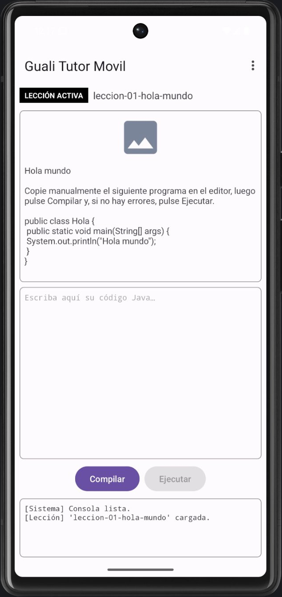

---

## 2. Prerrequisitos

### 2.1 Conocimientos

- Java básico: clases, métodos, variables y *lambdas* simples.
- Haber usado un IDE (IntelliJ IDEA o similar).

### 2.2 Hardware y sistema operativo

Requisitos publicados por Google para Android Studio (consulte siempre la [página oficial de instalación](https://developer.android.com/studio/install), porque pueden cambiar):

| Requisito | Mínimo | Recomendado |
|---|---|---|
| Sistema operativo | macOS 12 · Windows 10 de 64 bits | Última versión de 64 bits |
| Memoria RAM | 8 GB solo con Android Studio · **16 GB** con Android Studio y el emulador | 32 GB |
| Espacio en disco | 8 GB libres (solo Studio) · **16 GB** libres (Studio y emulador) | SSD con 32 GB o más |
| Resolución de pantalla | 1280 × 800 | 1920 × 1080 |


### 2.3 Software necesario

| Software | Para qué sirve | Dónde obtenerlo |
|---|---|---|
| **Android Studio** (versión estable más reciente; este tutorial se escribió con *Rabbit 2*, publicada el 28 de octubre de 2026, o posterior) | IDE oficial de Android. Incluye el SDK, el emulador y un JDK propio | <https://developer.android.com/studio> |
| **Android SDK** (plataforma Android reciente) | Librerías para compilar la app | Se instala desde el asistente de Android Studio |
| **Emulador de Android (AVD)** *o* un teléfono Android con depuración USB | Para ejecutar la app | Se crea en Android Studio (*Device Manager*) |
| Conexión a Internet | La primera sincronización descarga Gradle y dependencias | — |

> **¿Necesito instalar un JDK aparte?** No para este tutorial: Android Studio trae su propio JDK y lo usa para compilar el proyecto. (El JDK 25 que exige el curso para la aplicación de escritorio es independiente.)

---

## 3. Instalación del software

### 3.1 Descargar Android Studio

1. Abra <https://developer.android.com/studio> y descargue la versión estable para su sistema operativo. **En Mac, elija la versión que corresponde a su procesador** (Intel o Apple Silicon); puede verlo en  ▸ *Acerca de este Mac*.

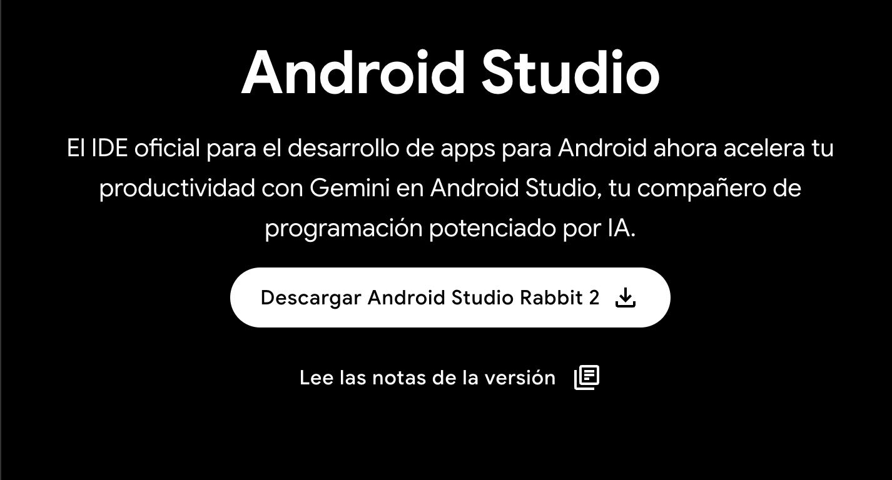

### 3.2 Instalarlo

- **macOS:** abra el archivo `.dmg` y arrastre **Android Studio** a la carpeta **Aplicaciones**. Luego ábralo desde allí.
- **Windows:** ejecute el instalador `.exe` y acepte las opciones predeterminadas.
- **Linux:** descomprima el `.tar.gz` y ejecute `studio.sh` desde la carpeta `bin`.


### 3.3 Asistente de bienvenida

1. Al abrirlo por primera vez, elija si importa configuraciones anteriores (si es su primera instalación, no importe nada).
2. En el asistente (*Setup Wizard*) elija la instalación **Standard** y acepte las licencias del SDK.
3. Espere a que termine la descarga de componentes (SDK, herramientas de plataforma y emulador).

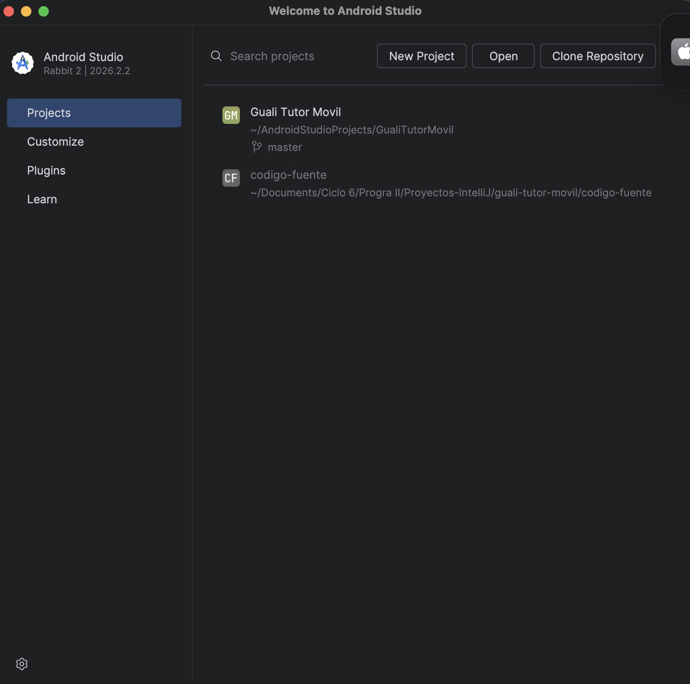

### 3.4 Verificar el SDK

Abra **Settings** (en Mac: *Android Studio ▸ Settings*) ▸ **Languages & Frameworks ▸ Android SDK** y confirme que hay al menos una **plataforma Android** instalada (marcada) en la pestaña *SDK Platforms*, y que *Android SDK Build-Tools* y *Android Emulator* aparecen instalados en *SDK Tools*.

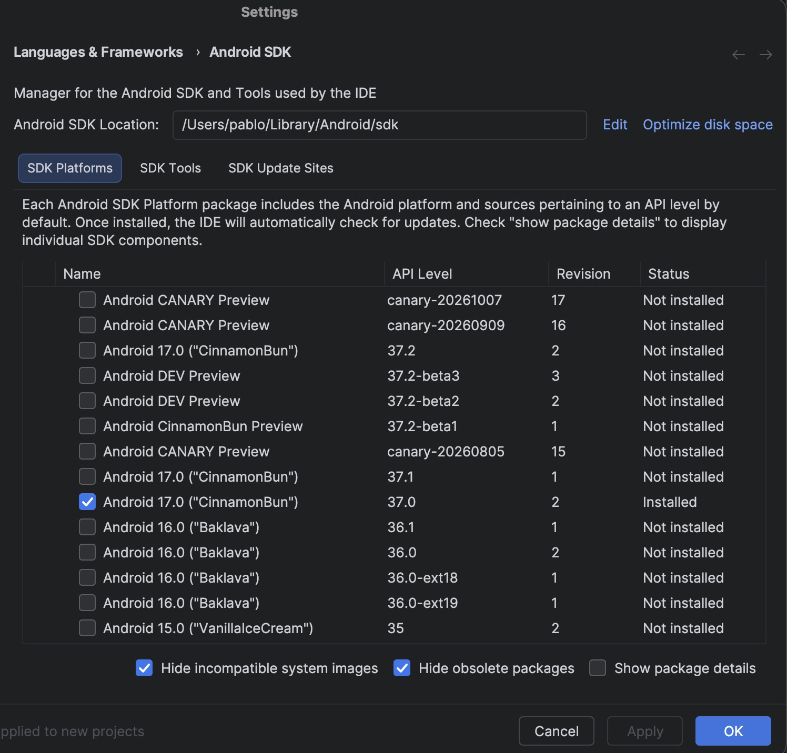

### 3.5 Preparar dónde ejecutar la app

**Opción A — Emulador (recomendada):**
1. Abra **Tools ▸ Device Manager** y pulse **Create Virtual Device** (el botón “+”).
2. Elija un teléfono (por ejemplo *Pixel*), pulse **Next**, elija una imagen del sistema reciente (descárguela si hace falta) y pulse **Finish**.

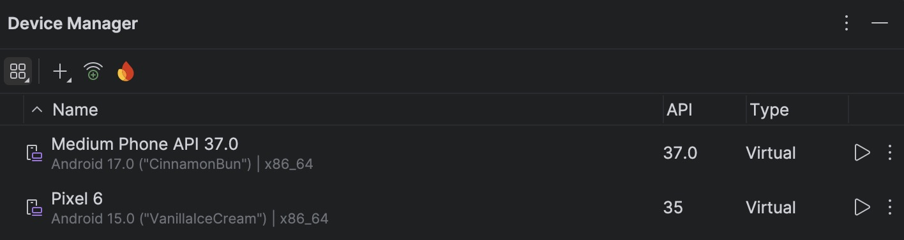

**Opción B — Teléfono real:** en el teléfono active las *Opciones de desarrollador* (toque siete veces el *Número de compilación* en *Ajustes ▸ Información del teléfono*), active la **Depuración por USB**, conéctelo con un cable USB y acepte la autorización que aparece en el teléfono.

---

## 4. Crear el proyecto

1. En la pantalla de bienvenida pulse **New Project** (o **File ▸ New ▸ New Project**).
2. En la pestaña **Phone and Tablet** elija la plantilla **Empty Views Activity** y pulse **Next**.

   > Es importante elegir *Views* y **no** la plantilla de *Compose*: este tutorial usa diseños en XML.

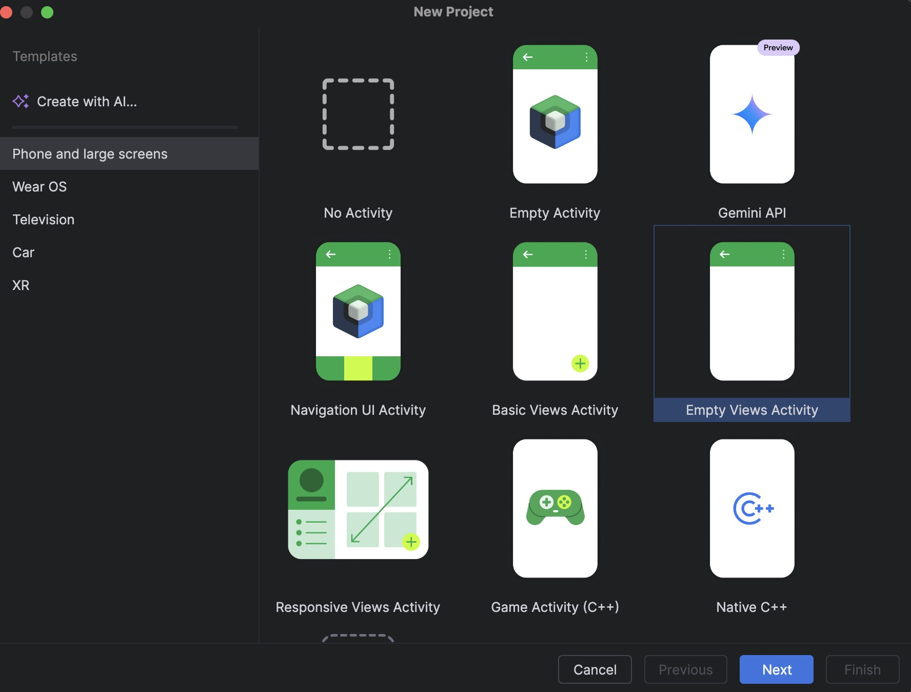

3. Configure el proyecto con estos valores:

| Campo | Valor |
|---|---|
| **Name** | `Guali Tutor Movil` |
| **Package name** | `com.guali.tutor.movil` |
| **Save location** | La carpeta donde quiera guardarlo |
| **Language** | **Java** |
| **Minimum SDK** | El valor que proponga el asistente |
| **Build configuration language** | El valor que proponga el asistente (Kotlin DSL) |

4. Pulse **Finish** y espere a que Gradle termine de sincronizar (la barra inferior deja de mostrar actividad).


5. Para confirmar que todo el entorno funciona, ejecute la app tal como viene: seleccione su dispositivo en la barra superior y pulse **Run ▶**. Debe aparecer una pantalla con el texto *Hello World!*.

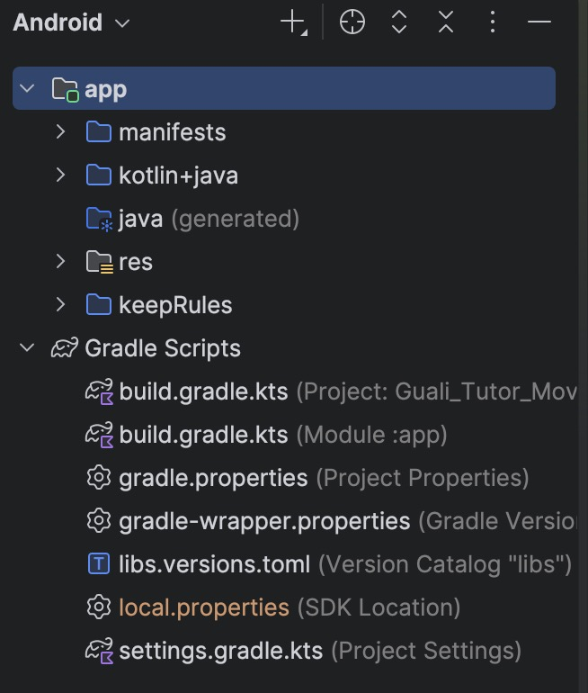


> **Cambie a la vista de proyecto Android.** En el panel izquierdo, el selector superior debe decir **Android**. Todas las rutas de este tutorial (por ejemplo `res/layout`) se refieren a esa vista, dentro de `app`.

---

## 5. Recursos: textos, colores y dibujos

Para no chocar con los archivos que genera la plantilla, todos los recursos de Guali Tutor se crean en **archivos nuevos** con el prefijo `guali_`.

### 5.1 Colores — `guali_colors.xml`

1. Clic derecho sobre **res ▸ values** ▸ **New ▸ Values Resource File**.
2. En *File name* escriba `guali_colors` y pulse **OK**.
3. Reemplace **todo** el contenido del archivo por:

```xml
<?xml version="1.0" encoding="utf-8"?>
<resources>
    <!-- Colores propios de Guali Tutor (prefijo guali_ para no chocar con los de la plantilla) -->
    <color name="guali_etiqueta_fondo">#000000</color>
    <color name="guali_etiqueta_texto">#FFFFFF</color>
    <color name="guali_borde">#9E9E9E</color>
    <color name="guali_icono">#7A869A</color>
</resources>
```

### 5.2 Textos — `guali_strings.xml`

Repita el procedimiento con el nombre `guali_strings` y pegue:

```xml
<?xml version="1.0" encoding="utf-8"?>
<resources>
    <!-- Barra de menú -->
    <string name="menu_lecciones">Lecciones</string>
    <string name="menu_configuracion">Configuración</string>
    <string name="menu_historial">Historial</string>
    <string name="menu_ayuda">Ayuda</string>
    <string name="accion_abrir_leccion">Abrir Lección</string>
    <string name="accion_cerrar_leccion">Cerrar Lección</string>
    <string name="accion_configurar_jdk">Configurar JDK</string>
    <string name="accion_ver_historial">Ver Historial</string>

    <!-- Interfaz principal -->
    <string name="etiqueta_leccion_activa">LECCIÓN ACTIVA</string>
    <string name="sin_leccion">(ninguna)</string>
    <string name="descripcion_imagen_leccion">Imagen de la lección activa</string>
    <string name="hint_editor">Escriba aquí su código Java…</string>
    <string name="btn_compilar">Compilar</string>
    <string name="btn_ejecutar">Ejecutar</string>

    <!-- Lección de ejemplo -->
    <string name="leccion_demo_nombre">leccion-01-hola-mundo</string>
    <string name="leccion_demo_descripcion">Hola mundo\n\nCopie manualmente el siguiente programa en el editor, luego pulse Compilar y, si no hay errores, pulse Ejecutar.\n\npublic class Hola {\n    public static void main(String[] args) {\n        System.out.println(\"Hola mundo\");\n    }\n}</string>

    <!-- Diálogos -->
    <string name="dialogo_jdk_titulo">Seleccione ubicación de su Java Development Kit (JDK)</string>
    <string name="dialogo_jdk_hint">/usr/lib/jvm/jdk-25</string>
    <string name="aceptar">Aceptar</string>
    <string name="cancelar">Cancelar</string>
    <string name="cerrar">Cerrar</string>
    <string name="historial_titulo">Historial de Sesión</string>
    <string name="historial_ejemplo">leccion-01-hola-mundo\n15/05/2026 4:30:10 PM · Pendiente\n\nleccion-01-hola-mundo\n15/05/2026 5:02:40 PM · Completada\n\nleccion-02-errores-compilacion\n15/05/2026 8:00:00 PM · Completada</string>
    <string name="ayuda_titulo">Ayuda</string>
    <string name="ayuda_texto">1. Abra una lección desde el menú Lecciones.\n2. Escriba el código en el editor.\n3. Pulse Compilar; si no hay errores se habilita Ejecutar.\n4. Revise el resultado en la consola.</string>

    <!-- Mensajes de la consola -->
    <string name="consola_inicial">[Sistema] Consola lista.</string>
    <string name="log_leccion_abierta">[Lección] \'%1$s\' cargada.</string>
    <string name="log_leccion_cerrada">[Lección] Lección cerrada.</string>
    <string name="log_jdk_guardado">[Configuración] Ruta del JDK: %1$s</string>
    <string name="log_jdk_vacio">[Configuración] No se configuró ninguna ruta de JDK.</string>
    <string name="log_sin_leccion">[Compilar] Abra una lección antes de compilar.</string>
    <string name="log_editor_vacio">[Compilar] El editor está vacío; no hay nada que compilar.</string>
    <string name="log_compilacion_ok">[Compilar] Compilación simulada: 0 errores.</string>
    <string name="log_ejecucion_ok">[Ejecutar] Ejecución simulada: el programa terminó sin errores.</string>
</resources>
```

> Todos los textos visibles viven aquí y no dentro del código. Esto permite traducir o cambiar la app sin tocar el diseño.

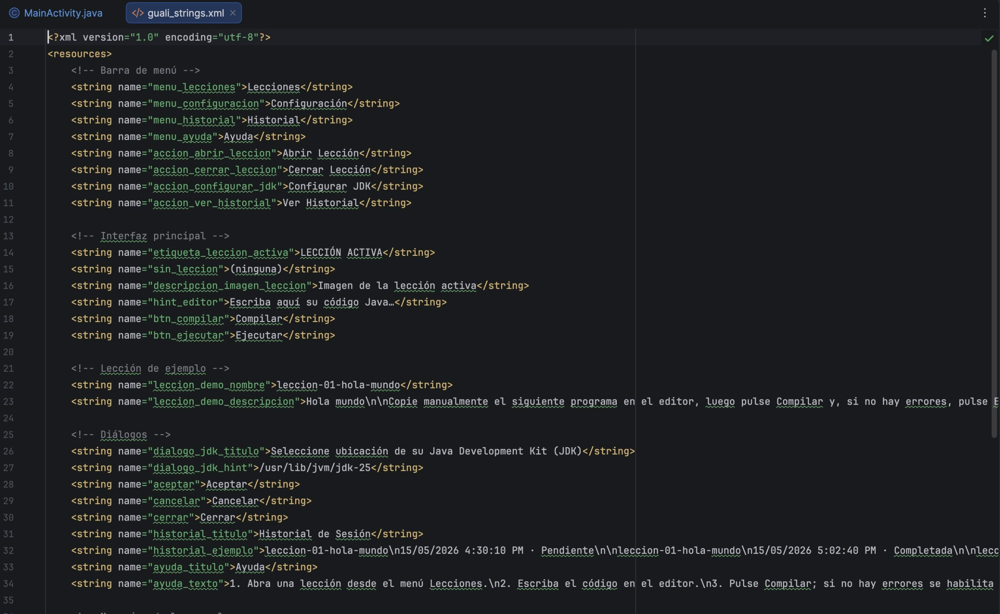

### 5.3 Fondo de los paneles — `bg_panel.xml`

1. Clic derecho sobre **res ▸ drawable** ▸ **New ▸ Drawable Resource File**.
2. *File name:* `bg_panel`; *Root element:* `shape`; pulse **OK**.
3. Reemplace todo el contenido por:

```xml
<?xml version="1.0" encoding="utf-8"?>
<shape xmlns:android="http://schemas.android.com/apk/res/android"
    android:shape="rectangle">
    <stroke
        android:width="1dp"
        android:color="@color/guali_borde" />
    <corners android:radius="6dp" />
</shape>
```

### 5.4 Imagen provisional de la lección — `ic_leccion_placeholder.xml`

Es el ícono de “imagen” que aparece en el panel de lección, como en el prototipo.

1. Clic derecho sobre **res ▸ drawable** ▸ **New ▸ Drawable Resource File**.
2. *File name:* `ic_leccion_placeholder`; *Root element:* `vector`; pulse **OK**.
3. Reemplace todo el contenido por:

```xml
<?xml version="1.0" encoding="utf-8"?>
<vector xmlns:android="http://schemas.android.com/apk/res/android"
    android:width="72dp"
    android:height="72dp"
    android:viewportWidth="24"
    android:viewportHeight="24">
    <path
        android:fillColor="@color/guali_icono"
        android:pathData="M21,19V5c0,-1.1 -0.9,-2 -2,-2H5c-1.1,0 -2,0.9 -2,2v14c0,1.1 0.9,2 2,2h14c1.1,0 2,-0.9 2,-2zM8.5,13.5l2.5,3.01L14.5,12l4.5,6H5l3.5,-4.5z" />
</vector>
```

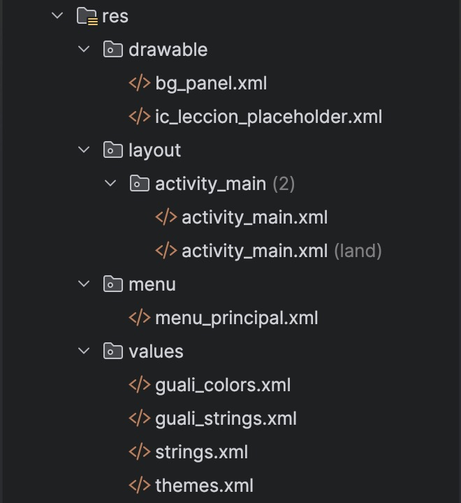

---

## 6. La barra de menú

El enunciado pide cuatro menús: **Lecciones**, **Configuración**, **Historial** y **Ayuda**. En Android se declaran en un XML dentro de `res/menu`.

1. Clic derecho sobre **res** ▸ **New ▸ Android Resource File**.
2. *File name:* `menu_principal`; *Resource type:* **Menu**; pulse **OK**.
3. Reemplace todo el contenido por:

```xml
<?xml version="1.0" encoding="utf-8"?>
<menu xmlns:android="http://schemas.android.com/apk/res/android"
    xmlns:app="http://schemas.android.com/apk/res-auto">

    <item
        android:id="@+id/menu_lecciones"
        android:title="@string/menu_lecciones"
        app:showAsAction="never">
        <menu>
            <item
                android:id="@+id/accion_abrir_leccion"
                android:title="@string/accion_abrir_leccion" />
            <item
                android:id="@+id/accion_cerrar_leccion"
                android:title="@string/accion_cerrar_leccion" />
        </menu>
    </item>

    <item
        android:id="@+id/menu_configuracion"
        android:title="@string/menu_configuracion"
        app:showAsAction="never">
        <menu>
            <item
                android:id="@+id/accion_configurar_jdk"
                android:title="@string/accion_configurar_jdk" />
        </menu>
    </item>

    <item
        android:id="@+id/menu_historial"
        android:title="@string/menu_historial"
        app:showAsAction="never">
        <menu>
            <item
                android:id="@+id/accion_ver_historial"
                android:title="@string/accion_ver_historial" />
        </menu>
    </item>

    <item
        android:id="@+id/accion_ayuda"
        android:title="@string/menu_ayuda"
        app:showAsAction="never" />
</menu>
```

Los tres primeros elementos contienen un submenú (`<menu>` anidado) con las opciones del enunciado. Con `app:showAsAction="never"` todos se agrupan en el menú de tres puntos (⋮) de la barra, que en un teléfono es la forma habitual de mostrar varios menús.


---

## 7. El diseño de la pantalla (vertical)

Aquí se arma la interfaz. Se usa un `LinearLayout` vertical con **pesos** (`layout_weight`) para que el panel de lección y el editor se repartan el espacio disponible, mientras que los botones y la consola mantienen su tamaño.

1. En **res ▸ layout** abra `activity_main.xml` (lo creó la plantilla).
2. Arriba a la derecha elija la vista **Code** (código) en lugar de *Design*.
3. Seleccione todo (`Ctrl+A` / `Cmd+A`) y reemplácelo por:

```xml
<?xml version="1.0" encoding="utf-8"?>
<LinearLayout xmlns:android="http://schemas.android.com/apk/res/android"
    xmlns:app="http://schemas.android.com/apk/res-auto"
    xmlns:tools="http://schemas.android.com/tools"
    android:id="@+id/main"
    android:layout_width="match_parent"
    android:layout_height="match_parent"
    android:background="?attr/colorSurface"
    android:orientation="vertical"
    tools:context=".MainActivity">

    <!-- 1. Barra de menú -->
    <com.google.android.material.appbar.MaterialToolbar
        android:id="@+id/toolbar"
        android:layout_width="match_parent"
        android:layout_height="?attr/actionBarSize"
        app:title="@string/app_name" />

    <!-- 2. Título de lección activa -->
    <LinearLayout
        android:layout_width="match_parent"
        android:layout_height="wrap_content"
        android:gravity="center_vertical"
        android:orientation="horizontal"
        android:paddingStart="8dp"
        android:paddingTop="4dp"
        android:paddingEnd="8dp"
        android:paddingBottom="4dp">

        <TextView
            android:id="@+id/tvEtiqueta"
            android:layout_width="wrap_content"
            android:layout_height="wrap_content"
            android:background="@color/guali_etiqueta_fondo"
            android:paddingStart="8dp"
            android:paddingTop="4dp"
            android:paddingEnd="8dp"
            android:paddingBottom="4dp"
            android:text="@string/etiqueta_leccion_activa"
            android:textColor="@color/guali_etiqueta_texto"
            android:textSize="12sp"
            android:textStyle="bold" />

        <TextView
            android:id="@+id/tvTituloLeccion"
            android:layout_width="0dp"
            android:layout_height="wrap_content"
            android:layout_weight="1"
            android:ellipsize="end"
            android:freezesText="true"
            android:maxLines="1"
            android:paddingStart="8dp"
            android:paddingEnd="8dp"
            android:text="@string/sin_leccion"
            android:textSize="16sp" />
    </LinearLayout>

    <!-- Zona de trabajo: panel de lección, editor, botones y consola (apilados) -->
    <LinearLayout
        android:layout_width="match_parent"
        android:layout_height="0dp"
        android:layout_weight="1"
        android:orientation="vertical"
        android:padding="8dp">

        <!-- 3. Panel de lección activa -->
        <LinearLayout
            android:layout_width="match_parent"
            android:layout_height="0dp"
            android:layout_weight="1"
            android:background="@drawable/bg_panel"
            android:orientation="vertical"
            android:padding="8dp">

            <ImageView
                android:id="@+id/ivLeccion"
                android:layout_width="match_parent"
                android:layout_height="72dp"
                android:contentDescription="@string/descripcion_imagen_leccion"
                android:src="@drawable/ic_leccion_placeholder" />

            <ScrollView
                android:layout_width="match_parent"
                android:layout_height="0dp"
                android:layout_marginTop="8dp"
                android:layout_weight="1">

                <TextView
                    android:id="@+id/tvDescripcion"
                    android:layout_width="match_parent"
                    android:layout_height="wrap_content"
                    android:freezesText="true"
                    android:textSize="14sp" />
            </ScrollView>
        </LinearLayout>

        <!-- 4. Editor de código -->
        <EditText
            android:id="@+id/etCodigo"
            android:layout_width="match_parent"
            android:layout_height="0dp"
            android:layout_marginTop="8dp"
            android:layout_weight="1"
            android:background="@drawable/bg_panel"
            android:gravity="top|start"
            android:hint="@string/hint_editor"
            android:importantForAutofill="no"
            android:inputType="textMultiLine|textNoSuggestions"
            android:padding="8dp"
            android:textSize="13sp"
            android:typeface="monospace" />

        <!-- Botones de acción -->
        <LinearLayout
            android:layout_width="match_parent"
            android:layout_height="wrap_content"
            android:layout_marginTop="8dp"
            android:gravity="center"
            android:orientation="horizontal">

            <com.google.android.material.button.MaterialButton
                android:id="@+id/btnCompilar"
                android:layout_width="wrap_content"
                android:layout_height="wrap_content"
                android:layout_marginEnd="8dp"
                android:text="@string/btn_compilar" />

            <com.google.android.material.button.MaterialButton
                android:id="@+id/btnEjecutar"
                android:layout_width="wrap_content"
                android:layout_height="wrap_content"
                android:enabled="false"
                android:text="@string/btn_ejecutar" />
        </LinearLayout>

        <!-- 5. Panel de consola -->
        <ScrollView
            android:id="@+id/svConsola"
            android:layout_width="match_parent"
            android:layout_height="96dp"
            android:layout_marginTop="8dp"
            android:background="@drawable/bg_panel">

            <TextView
                android:id="@+id/tvConsola"
                android:layout_width="match_parent"
                android:layout_height="wrap_content"
                android:freezesText="true"
                android:padding="8dp"
                android:textSize="12sp"
                android:typeface="monospace" />
        </ScrollView>
    </LinearLayout>
</LinearLayout>
```

**Cómo leerlo.** El archivo sigue el orden de la pantalla, de arriba abajo:

- `MaterialToolbar` → la **barra de menú**.
- Primer `LinearLayout` horizontal → la etiqueta negra **LECCIÓN ACTIVA** y el nombre de la lección.
- Segundo `LinearLayout` (`layout_weight="1"`) → la zona de trabajo, que contiene en orden: el **panel de lección** (imagen + descripción con *scroll*), el **editor de código** (`EditText`), los **botones** y la **consola**.
- `android:id` da a cada vista un nombre para usarla desde Java. `android:enabled="false"` en `btnEjecutar` hace que Ejecutar empiece deshabilitado.

Cambie a la vista **Design** para ver una vista previa del diseño.

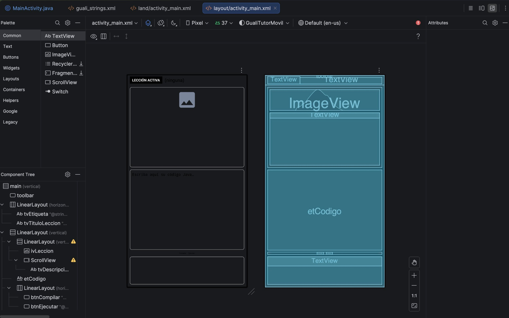

---

## 8. El diseño horizontal

Cuando el dispositivo gira, Android busca primero un diseño en la carpeta `layout-land`. Allí colocaremos la versión en **dos columnas** (lección a la izquierda; editor, botones y consola a la derecha), que se parece más al prototipo del enunciado.

1. Clic derecho sobre **res** ▸ **New ▸ Android Resource File**.
2. *File name:* `activity_main`; *Resource type:* **Layout**; *Root element:* `LinearLayout`.
3. En *Available qualifiers* seleccione **Orientation**, pulse el botón **>>** y en *Screen orientation* elija **Landscape**. La carpeta de destino debe mostrar `layout-land`. Pulse **OK**.
4. Reemplace todo el contenido por:

```xml
<?xml version="1.0" encoding="utf-8"?>
<LinearLayout xmlns:android="http://schemas.android.com/apk/res/android"
    xmlns:app="http://schemas.android.com/apk/res-auto"
    xmlns:tools="http://schemas.android.com/tools"
    android:id="@+id/main"
    android:layout_width="match_parent"
    android:layout_height="match_parent"
    android:background="?attr/colorSurface"
    android:orientation="vertical"
    tools:context=".MainActivity">

    <!-- 1. Barra de menú -->
    <com.google.android.material.appbar.MaterialToolbar
        android:id="@+id/toolbar"
        android:layout_width="match_parent"
        android:layout_height="?attr/actionBarSize"
        app:title="@string/app_name" />

    <!-- 2. Título de lección activa -->
    <LinearLayout
        android:layout_width="match_parent"
        android:layout_height="wrap_content"
        android:gravity="center_vertical"
        android:orientation="horizontal"
        android:paddingStart="8dp"
        android:paddingTop="4dp"
        android:paddingEnd="8dp"
        android:paddingBottom="4dp">

        <TextView
            android:id="@+id/tvEtiqueta"
            android:layout_width="wrap_content"
            android:layout_height="wrap_content"
            android:background="@color/guali_etiqueta_fondo"
            android:paddingStart="8dp"
            android:paddingTop="4dp"
            android:paddingEnd="8dp"
            android:paddingBottom="4dp"
            android:text="@string/etiqueta_leccion_activa"
            android:textColor="@color/guali_etiqueta_texto"
            android:textSize="12sp"
            android:textStyle="bold" />

        <TextView
            android:id="@+id/tvTituloLeccion"
            android:layout_width="0dp"
            android:layout_height="wrap_content"
            android:layout_weight="1"
            android:ellipsize="end"
            android:freezesText="true"
            android:maxLines="1"
            android:paddingStart="8dp"
            android:paddingEnd="8dp"
            android:text="@string/sin_leccion"
            android:textSize="16sp" />
    </LinearLayout>

    <!-- Zona de trabajo en dos columnas, como en el mock: lección a la izquierda; editor, botones y consola a la derecha -->
    <LinearLayout
        android:layout_width="match_parent"
        android:layout_height="0dp"
        android:layout_weight="1"
        android:orientation="horizontal"
        android:padding="8dp">

        <!-- 3. Panel de lección activa -->
        <LinearLayout
            android:layout_width="0dp"
            android:layout_height="match_parent"
            android:layout_weight="1"
            android:background="@drawable/bg_panel"
            android:orientation="vertical"
            android:padding="8dp">

            <ImageView
                android:id="@+id/ivLeccion"
                android:layout_width="match_parent"
                android:layout_height="72dp"
                android:contentDescription="@string/descripcion_imagen_leccion"
                android:src="@drawable/ic_leccion_placeholder" />

            <ScrollView
                android:layout_width="match_parent"
                android:layout_height="0dp"
                android:layout_marginTop="8dp"
                android:layout_weight="1">

                <TextView
                    android:id="@+id/tvDescripcion"
                    android:layout_width="match_parent"
                    android:layout_height="wrap_content"
                    android:freezesText="true"
                    android:textSize="14sp" />
            </ScrollView>
        </LinearLayout>

        <LinearLayout
            android:layout_width="0dp"
            android:layout_height="match_parent"
            android:layout_marginStart="8dp"
            android:layout_weight="1.4"
            android:orientation="vertical">

            <!-- 4. Editor de código -->
            <EditText
                android:id="@+id/etCodigo"
                android:layout_width="match_parent"
                android:layout_height="0dp"
                android:layout_weight="1"
                android:background="@drawable/bg_panel"
                android:gravity="top|start"
                android:hint="@string/hint_editor"
                android:importantForAutofill="no"
                android:inputType="textMultiLine|textNoSuggestions"
                android:padding="8dp"
                android:textSize="13sp"
                android:typeface="monospace" />

            <!-- Botones de acción -->
            <LinearLayout
                android:layout_width="match_parent"
                android:layout_height="wrap_content"
                android:layout_marginTop="4dp"
                android:gravity="center"
                android:orientation="horizontal">

                <com.google.android.material.button.MaterialButton
                    android:id="@+id/btnCompilar"
                    android:layout_width="wrap_content"
                    android:layout_height="wrap_content"
                    android:layout_marginEnd="8dp"
                    android:text="@string/btn_compilar" />

                <com.google.android.material.button.MaterialButton
                    android:id="@+id/btnEjecutar"
                    android:layout_width="wrap_content"
                    android:layout_height="wrap_content"
                    android:enabled="false"
                    android:text="@string/btn_ejecutar" />
            </LinearLayout>

            <!-- 5. Panel de consola -->
            <ScrollView
                android:id="@+id/svConsola"
                android:layout_width="match_parent"
                android:layout_height="80dp"
                android:layout_marginTop="4dp"
                android:background="@drawable/bg_panel">

                <TextView
                    android:id="@+id/tvConsola"
                    android:layout_width="match_parent"
                    android:layout_height="wrap_content"
                    android:freezesText="true"
                    android:padding="8dp"
                    android:textSize="12sp"
                    android:typeface="monospace" />
            </ScrollView>
        </LinearLayout>
    </LinearLayout>
</LinearLayout>
```

> Los **ids son exactamente los mismos** que en el diseño vertical. Así el código Java funciona sin cambios en ambas orientaciones.

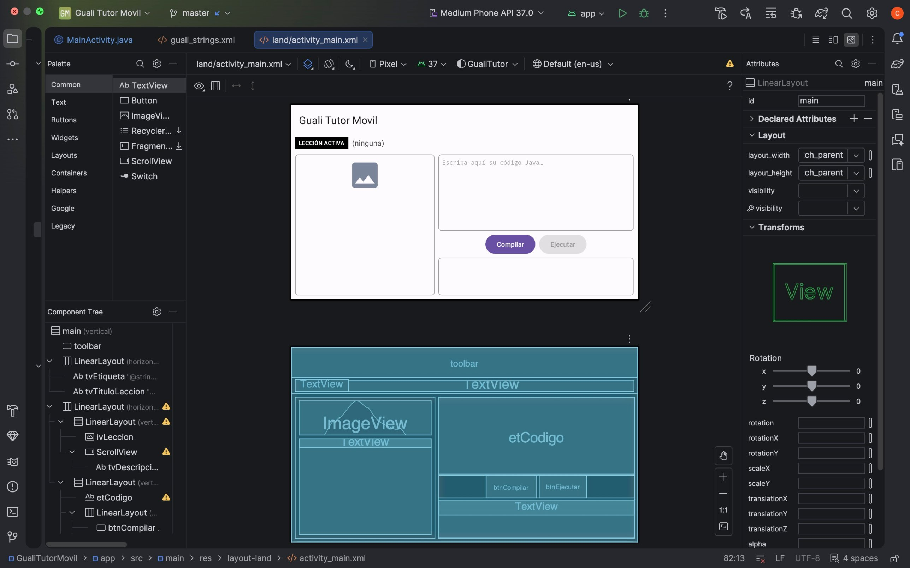

---

## 9. La lógica: MainActivity

Abra `java/com/guali/tutor/movil/MainActivity` y **reemplace todo el contenido** por el siguiente código (la primera línea, `package`, debe coincidir con el nombre de paquete que eligió):

```java
package com.guali.tutor.movil;

import android.os.Bundle;
import android.text.Editable;
import android.text.TextWatcher;
import android.view.MenuItem;
import android.view.View;
import android.view.ViewGroup;
import android.widget.EditText;
import android.widget.FrameLayout;
import android.widget.ScrollView;
import android.widget.TextView;

import androidx.appcompat.app.AppCompatActivity;
import androidx.core.graphics.Insets;
import androidx.core.view.ViewCompat;
import androidx.core.view.WindowInsetsCompat;

import com.google.android.material.appbar.MaterialToolbar;
import com.google.android.material.button.MaterialButton;
import com.google.android.material.dialog.MaterialAlertDialogBuilder;

/**
 * Pantalla principal de Guali Tutor (front end móvil). Reúne los cinco elementos de la
 * "Interfaz Principal": barra de menú, título de lección activa, panel de lección activa,
 * editor de código y panel de consola, más los botones Compilar y Ejecutar.
 *
 * Por ahora la compilación y la ejecución son simuladas: esta fase solo construye la interfaz.
 */
public class MainActivity extends AppCompatActivity {

    private TextView tvTituloLeccion;
    private TextView tvDescripcion;
    private TextView tvConsola;
    private ScrollView svConsola;
    private EditText etCodigo;
    private MaterialButton btnCompilar;
    private MaterialButton btnEjecutar;

    /** Ruta del JDK escrita en el diálogo "Configurar JDK" (por ahora solo se guarda en memoria). */
    private String rutaJdk = "";

    /** true si la compilación más reciente fue exitosa: solo entonces se habilita Ejecutar. */
    private boolean compilacionExitosa = false;

    @Override
    protected void onCreate(Bundle savedInstanceState) {
        super.onCreate(savedInstanceState);
        setContentView(R.layout.activity_main);

        // Deja el contenido fuera de las barras del sistema y del teclado.
        View raiz = findViewById(R.id.main);
        ViewCompat.setOnApplyWindowInsetsListener(raiz, (vista, insets) -> {
            Insets margenes = insets.getInsets(
                    WindowInsetsCompat.Type.systemBars() | WindowInsetsCompat.Type.ime());
            vista.setPadding(margenes.left, margenes.top, margenes.right, margenes.bottom);
            return insets;
        });

        enlazarVistas();
        configurarMenu();
        configurarBotones();
        configurarEditor();

        // Solo la primera vez: al rotar la pantalla Android restaura los textos guardados.
        if (savedInstanceState == null) {
            registrarConsola(getString(R.string.consola_inicial));
            abrirLeccionDemo();
        }
    }

    // ------------------------------------------------------------------
    // Configuración inicial
    // ------------------------------------------------------------------

    private void enlazarVistas() {
        tvTituloLeccion = findViewById(R.id.tvTituloLeccion);
        tvDescripcion = findViewById(R.id.tvDescripcion);
        tvConsola = findViewById(R.id.tvConsola);
        svConsola = findViewById(R.id.svConsola);
        etCodigo = findViewById(R.id.etCodigo);
        btnCompilar = findViewById(R.id.btnCompilar);
        btnEjecutar = findViewById(R.id.btnEjecutar);
    }

    private void configurarMenu() {
        MaterialToolbar barra = findViewById(R.id.toolbar);
        barra.inflateMenu(R.menu.menu_principal);
        barra.setOnMenuItemClickListener(this::alSeleccionarMenu);
    }

    private void configurarBotones() {
        btnCompilar.setOnClickListener(vista -> alPulsarCompilar());
        btnEjecutar.setOnClickListener(vista -> alPulsarEjecutar());
    }

    private void configurarEditor() {
        // Si el estudiante modifica el código, la compilación anterior deja de valer.
        etCodigo.addTextChangedListener(new TextWatcher() {
            @Override
            public void beforeTextChanged(CharSequence s, int start, int count, int after) {
            }

            @Override
            public void onTextChanged(CharSequence s, int start, int before, int count) {
            }

            @Override
            public void afterTextChanged(Editable s) {
                if (compilacionExitosa) {
                    compilacionExitosa = false;
                    actualizarBotonEjecutar();
                }
            }
        });
    }

    // ------------------------------------------------------------------
    // Menú
    // ------------------------------------------------------------------

    private boolean alSeleccionarMenu(MenuItem opcion) {
        int id = opcion.getItemId();
        if (id == R.id.accion_abrir_leccion) {
            abrirLeccionDemo();
            return true;
        } else if (id == R.id.accion_cerrar_leccion) {
            cerrarLeccion();
            return true;
        } else if (id == R.id.accion_configurar_jdk) {
            mostrarDialogoJdk();
            return true;
        } else if (id == R.id.accion_ver_historial) {
            mostrarHistorial();
            return true;
        } else if (id == R.id.accion_ayuda) {
            mostrarAyuda();
            return true;
        }
        return false;
    }

    // ------------------------------------------------------------------
    // Lecciones
    // ------------------------------------------------------------------

    private boolean hayLeccionAbierta() {
        return !getString(R.string.sin_leccion).contentEquals(tvTituloLeccion.getText());
    }

    private void abrirLeccionDemo() {
        String nombre = getString(R.string.leccion_demo_nombre);
        tvTituloLeccion.setText(nombre);
        tvDescripcion.setText(R.string.leccion_demo_descripcion);
        etCodigo.setText("");
        registrarConsola(getString(R.string.log_leccion_abierta, nombre));
    }

    private void cerrarLeccion() {
        tvTituloLeccion.setText(R.string.sin_leccion);
        tvDescripcion.setText("");
        etCodigo.setText("");
        registrarConsola(getString(R.string.log_leccion_cerrada));
    }

    // ------------------------------------------------------------------
    // Botones de acción (simulados)
    // ------------------------------------------------------------------

    private void alPulsarCompilar() {
        compilacionExitosa = false;
        if (!hayLeccionAbierta()) {
            registrarConsola(getString(R.string.log_sin_leccion));
        } else if (etCodigo.getText().toString().trim().isEmpty()) {
            registrarConsola(getString(R.string.log_editor_vacio));
        } else {
            compilacionExitosa = true;
            registrarConsola(getString(R.string.log_compilacion_ok));
        }
        actualizarBotonEjecutar();
    }

    private void alPulsarEjecutar() {
        if (compilacionExitosa) {
            registrarConsola(getString(R.string.log_ejecucion_ok));
        }
    }

    private void actualizarBotonEjecutar() {
        btnEjecutar.setEnabled(compilacionExitosa);
    }

    // ------------------------------------------------------------------
    // Diálogos
    // ------------------------------------------------------------------

    private void mostrarDialogoJdk() {
        final EditText campo = new EditText(this);
        campo.setSingleLine(true);
        campo.setHint(R.string.dialogo_jdk_hint);
        campo.setText(rutaJdk);

        // Contenedor con márgenes para que el campo no quede pegado a los bordes del diálogo.
        int margen = (int) (20 * getResources().getDisplayMetrics().density);
        FrameLayout contenedor = new FrameLayout(this);
        FrameLayout.LayoutParams parametros = new FrameLayout.LayoutParams(
                ViewGroup.LayoutParams.MATCH_PARENT, ViewGroup.LayoutParams.WRAP_CONTENT);
        parametros.setMargins(margen, margen / 2, margen, 0);
        campo.setLayoutParams(parametros);
        contenedor.addView(campo);

        new MaterialAlertDialogBuilder(this)
                .setTitle(R.string.dialogo_jdk_titulo)
                .setView(contenedor)
                .setPositiveButton(R.string.aceptar, (dialogo, boton) -> {
                    rutaJdk = campo.getText().toString().trim();
                    if (rutaJdk.isEmpty()) {
                        registrarConsola(getString(R.string.log_jdk_vacio));
                    } else {
                        registrarConsola(getString(R.string.log_jdk_guardado, rutaJdk));
                    }
                })
                .setNegativeButton(R.string.cancelar, null)
                .show();
    }

    private void mostrarHistorial() {
        new MaterialAlertDialogBuilder(this)
                .setTitle(R.string.historial_titulo)
                .setMessage(R.string.historial_ejemplo)
                .setPositiveButton(R.string.cerrar, null)
                .show();
    }

    private void mostrarAyuda() {
        new MaterialAlertDialogBuilder(this)
                .setTitle(R.string.ayuda_titulo)
                .setMessage(R.string.ayuda_texto)
                .setPositiveButton(R.string.cerrar, null)
                .show();
    }

    // ------------------------------------------------------------------
    // Consola
    // ------------------------------------------------------------------

    private void registrarConsola(String mensaje) {
        tvConsola.append(mensaje + "\n");
        // Desplaza la consola hasta la última línea.
        svConsola.post(() -> svConsola.fullScroll(View.FOCUS_DOWN));
    }
}
```

**Qué hace cada bloque**

| Bloque | Función |
|---|---|
| `onCreate` | Carga el diseño, ajusta los márgenes a las barras del sistema y del teclado, enlaza las vistas y abre una lección de ejemplo la primera vez. |
| `enlazarVistas` | `findViewById` de cada elemento del diseño. |
| `configurarMenu` | Infla `menu_principal` en la barra y registra el método que atiende los clics. |
| `alSeleccionarMenu` | Según la opción pulsada: abre o cierra la lección, muestra el diálogo del JDK, el historial o la ayuda. |
| `abrirLeccionDemo` / `cerrarLeccion` | Muestran u ocultan el título, la descripción y el contenido del editor. |
| `alPulsarCompilar` / `alPulsarEjecutar` | Simulan la compilación y la ejecución y escriben el resultado en la consola. **Ejecutar solo se habilita tras una compilación exitosa.** |
| `configurarEditor` | Si el estudiante modifica el código, la compilación anterior deja de ser válida y Ejecutar se deshabilita. |
| `mostrarDialogoJdk` | Diálogo “Seleccione ubicación de su Java Development Kit (JDK)” con *Aceptar* y *Cancelar*, como el prototipo. |
| `registrarConsola` | Añade una línea a la consola y la desplaza hasta el final. |

Si Android Studio marca `R` en rojo, use **Build ▸ Make Project** (o el ícono *Sync Project with Gradle Files*) para que se generen los identificadores.

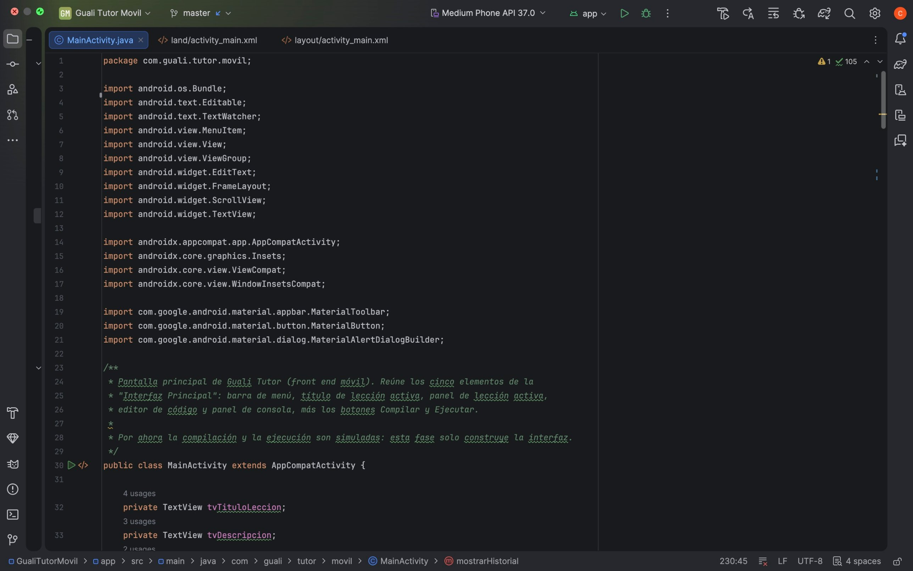

---

## 10. Ejecutar y probar

Seleccione su dispositivo y pulse **Run ▶**. Recorra esta lista para verificar cada elemento del enunciado:

| # | Prueba | Resultado esperado |
|---|---|---|
| 1 | Abrir la app | Se ve la barra superior, la etiqueta **LECCIÓN ACTIVA** con `leccion-01-hola-mundo`, el panel de lección, el editor vacío, los botones y la consola con mensajes iniciales. |
| 2 | Observar los botones | **Compilar** está habilitado; **Ejecutar** está deshabilitado (gris). |
| 3 | Pulsar **Compilar** con el editor vacío | La consola indica que no hay nada que compilar; Ejecutar sigue deshabilitado. |
| 4 | Escribir el código de la lección y pulsar **Compilar** | La consola muestra “Compilación simulada: 0 errores” y **Ejecutar se habilita**. |
| 5 | Pulsar **Ejecutar** | La consola muestra “Ejecución simulada…”. |
| 6 | Modificar el código del editor | **Ejecutar vuelve a deshabilitarse**. |
| 7 | Menú ⋮ ▸ **Lecciones** ▸ **Cerrar Lección** | Título `(ninguna)`, descripción y editor vacíos. |
| 8 | Menú ⋮ ▸ **Lecciones** ▸ **Abrir Lección** | Vuelve a cargarse `leccion-01-hola-mundo`. |
| 9 | Menú ⋮ ▸ **Configuración** ▸ **Configurar JDK** | Aparece el diálogo; al pulsar *Aceptar* la ruta se registra en la consola. |
| 10 | Menú ⋮ ▸ **Historial** ▸ **Ver Historial** | Aparece un diálogo con registros de ejemplo y el botón *Cerrar*. |
| 11 | Menú ⋮ ▸ **Ayuda** | Aparece el diálogo de ayuda. |
| 12 | Girar el dispositivo | La pantalla pasa a dos columnas, sin perder lo escrito en el editor. |


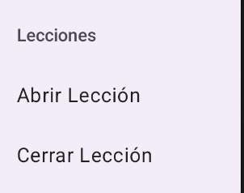
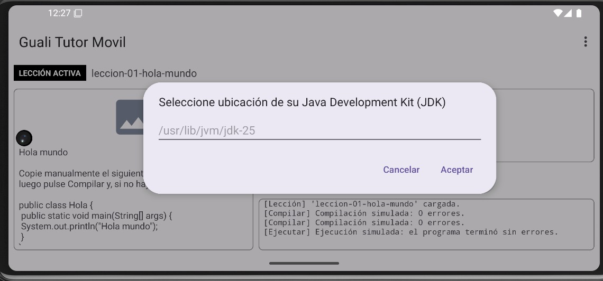
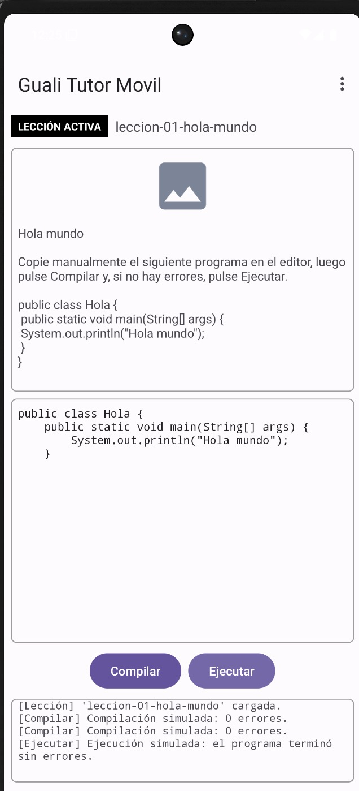
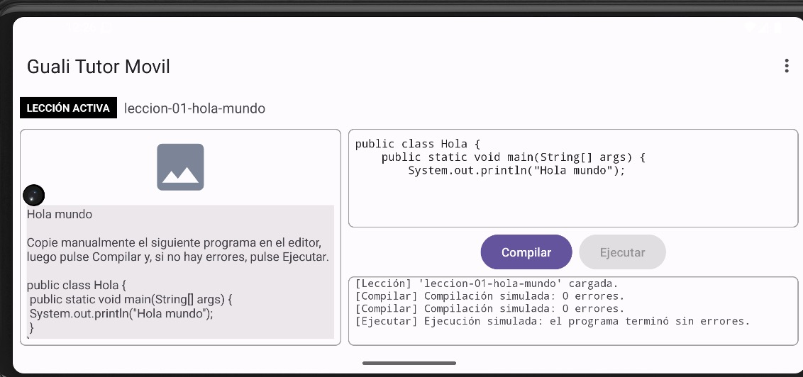
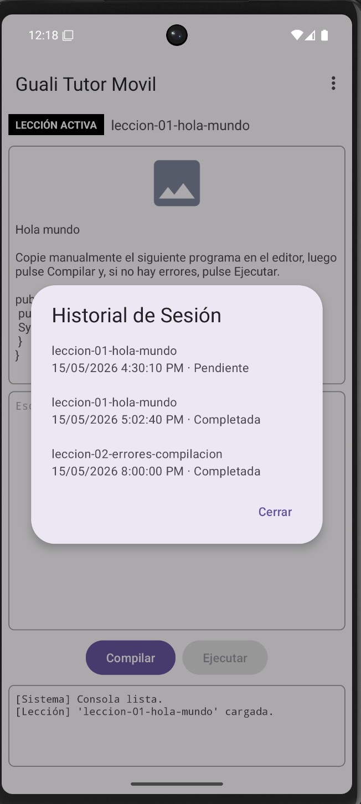

---

## 11. Solución de problemas

| Síntoma | Causa probable y solución |
|---|---|
| `R` o un `R.id.…` aparece en rojo | Aún no se generaron los recursos. Ejecute **Build ▸ Make Project** o sincronice con Gradle. Si persiste, revise que no haya errores en los XML (se marcan en rojo en la pestaña del archivo). |
| La app se cierra al abrir y el error de Logcat menciona `Theme.MaterialComponents` o un tema de Material | `MaterialToolbar` y `MaterialButton` necesitan un tema de Material. Abra `res/values/themes.xml` y compruebe que el estilo base hereda de `Theme.Material3.…` (la plantilla *Empty Views Activity* ya lo hace). |
| Se ve una barra de título duplicada | El tema tiene barra de acción. Use un tema `…NoActionBar` (por ejemplo `Theme.Material3.DayNight.NoActionBar`) en `themes.xml`. |
| *“Duplicate resources”* | Un nombre de recurso está repetido. Los recursos de este tutorial usan nombres con prefijo `guali_`; revise que no pegó el mismo contenido en dos archivos. |
| El menú ⋮ no muestra las opciones | Verifique que `configurarMenu()` se llama en `onCreate` y que el archivo se llama exactamente `menu_principal.xml`. |
| La barra superior queda detrás de la barra de estado | Compruebe que el diseño raíz tiene `android:id="@+id/main"` y que el bloque `setOnApplyWindowInsetsListener` está en `onCreate`. |
| El emulador no inicia o va muy lento | Revise los requisitos de RAM/disco (sección 2.2) y que la virtualización esté habilitada. Pruebe con un teléfono real como alternativa. |
| Gradle no logra sincronizar | Verifique su conexión a Internet y pulse **File ▸ Sync Project with Gradle Files**. |

---

## 12. Estructura final del proyecto

Los archivos que usted creó o modificó dentro de `app/src/main`:

```
app/src/main/
├── java/com/guali/tutor/movil/
│   └── MainActivity.java              ← lógica de la pantalla
└── res/
    ├── drawable/
    │   ├── bg_panel.xml               ← borde de los paneles
    │   └── ic_leccion_placeholder.xml ← imagen provisional de la lección
    ├── layout/
    │   └── activity_main.xml          ← diseño vertical
    ├── layout-land/
    │   └── activity_main.xml          ← diseño horizontal (dos columnas)
    ├── menu/
    │   └── menu_principal.xml         ← barra de menú
    └── values/
        ├── guali_colors.xml           ← colores
        └── guali_strings.xml          ← textos
```

El código fuente completo de estos archivos está también en la carpeta [`codigo-fuente`](codigo-fuente/) de este repositorio.

---

*Pablo Andres Pichardo Galindo · Carné 3190-24-19124 · Programación II · UMG · 2026*
